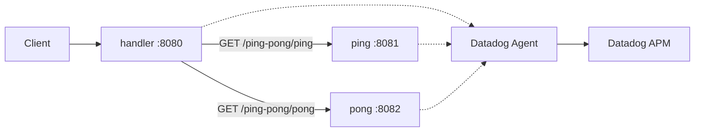

# Ping-Pong

A Spring Boot REST API that returns `PING` or `PONG`. It is set up to run locally, on Minikube, or on Google Kubernetes Engine, with Datadog APM enabled through the Datadog Java tracer and the Datadog Agent.

Three services:

| Service | Port | Role |
| --- | --- | --- |
| `handler` | 8080 | Front door. Calls `ping` and `pong` and returns their response. |
| `ping` | 8081 | `GET /ping-pong/ping` returns `PING`. |
| `pong` | 8082 | `GET /ping-pong/pong` returns `PONG`. |

## Architecture



Solid arrows are HTTP calls. Dotted arrows are traces. The prod handler image starts the JVM with `dd-java-agent.jar`. Cluster manifests also set Datadog Unified Service Tags (`DD_ENV`, `DD_SERVICE`, `DD_VERSION`), and the Helm values turn on APM instrumentation so the Agent can receive those traces.

## Run locally

Requires JDK 21 and Maven. `ping` and `pong` default to the `dev` profile. `handler` defaults to `prod` (Kubernetes service names), so start it with the `dev` profile when everything is on localhost.

```bash
# from ping/, pong/, and handler/ respectively
mvn spring-boot:run
mvn spring-boot:run
mvn spring-boot:run -Dspring-boot.run.arguments="--spring.profiles.active=dev"
```

| Call | Result |
| --- | --- |
| `GET http://localhost:8081/ping-pong/ping` | `PING` |
| `GET http://localhost:8082/ping-pong/pong` | `PONG` |
| `GET http://localhost:8080/ping-pong/ping` | `handler` calls `ping` and returns `PING` |
| `GET http://localhost:8080/ping-pong/pong` | `handler` calls `pong` and returns `PONG` |

## Container images

From the repo root:

```bash
docker build -f Dockerfile-ping -t ping:1.0 .
docker build -f Dockerfile-pong -t pong:1.0 .
docker build -f Dockerfile-handler-prod -t handler:1.0 .
```

`Dockerfile-handler-dev` is the same service without the Java tracer. Minikube loads the `:1.0` tags above. The GKE push scripts expect those same local tags.

## Deploy to Minikube

Requires Docker, Minikube, kubectl, and Helm. The Datadog API key is read from the environment. Do not write it into a script or manifest.

```bash
export DD_API_KEY="your-datadog-api-key"
```

`minikube/02-deploy-dd-agent-helm.sh` exits if `DD_API_KEY` is unset. Run the scripts from `minikube/` so the relative paths resolve:

```bash
cd minikube
bash 00-load-docker-images-into-minikube.sh
bash 02-deploy-dd-agent-helm.sh
bash 03-deploy-ping-pong.sh
```

`03` creates the `ping-pong` namespace from `01-namespace.yaml` when it is missing, applies the service and deployment manifests under `ping/minikube`, `pong/minikube`, and `handler/minikube`, then port-forwards `svc/handler` to `localhost:8080`.

To remove the app and the Agent:

```bash
bash 04-undeploy-ping-pong.sh
bash 05-undeploy-dd-agent-helm.sh
```

`04` deletes the namespace. `05` deletes the `datadog-agent-cluster-agent` deployment.

## Deploy to GKE

Requires the Google Cloud SDK, kubectl, Helm, and Docker, plus a GCP project with GKE and Artifact Registry available. Export `DD_API_KEY` the same way as for Minikube. `gke/02-deploy-dd-agent-helm.sh` exits if it is unset and stores the value in the `datadog-secret` Kubernetes secret.

The scripts hardcode project, region, VPC, and cluster names, and those names are not the same in every file. Edit them so they point at your project before you run them.

| Script | What it targets |
| --- | --- |
| `gke/00-create-vpc.sh` | VPC `my-vpc` in `northamerica-south1` |
| `gke/00-push-images-to-artifact-registry-mx.sh` | Artifact Registry `pingpong-mx` in `northamerica-south1` |
| `gke/00-push-images-to-artifact-registry-us.sh` | Artifact Registry `pingpong-us` in `us-central1` |
| `gke/01-create-gke-cluster-mx.sh` | Cluster `one-more-cluster-mx` |
| `gke/01-create-gke-cluster-us.sh` | Cluster `dev-cluster-us` |
| `gke/07-delete-gke-cluster.sh` | Cluster `dev-pingpong-cluster` in `northamerica-south1` |
| `gke/10-scale-down-gke-cluster.sh` | Cluster `bigfito-cluster` in `northamerica-south1`, scaled to 0 nodes |

Pick one region and run that region's scripts from `gke/`:

```bash
cd gke
bash 00-create-vpc.sh                              # northamerica-south1 only
bash 00-push-images-to-artifact-registry-mx.sh     # or the -us.sh script
bash 01-create-gke-cluster-mx.sh                   # or the -us.sh script
export DD_API_KEY="your-datadog-api-key"
bash 02-deploy-dd-agent-helm.sh
bash 04-deploy-ping-pong-services.sh
bash 04-deploy-ping-pong-deployments.sh
```

`04-deploy-ping-pong-services.sh` and `04-deploy-ping-pong-deployments.sh` apply `gke/03-namespace.yaml` when the `ping-pong` namespace is missing. On GKE, `handler` is a `LoadBalancer` on port 8080. `ping` and `pong` stay on `ClusterIP`.

The GKE deployments currently set `image: bigfito/ping:1.0`, `bigfito/pong:1.0`, and `bigfito/handler:1.0`. The Artifact Registry image lines in those manifests are commented out. Point `image:` at the tag you pushed before applying them.

`gke/08-apache-httpd-test.yaml` and `gke/09-alpine-tools-test.yaml` are sample workloads. They are not part of ping-pong.

To tear the app down:

```bash
bash 05-undeploy-ping-pong.sh          # deletes the ping-pong namespace
bash 06-undeploy-dd-agent-helm.sh      # deletes the Agent deployment, DaemonSet, and services
bash 07-delete-gke-cluster.sh          # deletes the cluster named in that script
```

`10-scale-down-gke-cluster.sh` resizes a node pool to zero when you want the cluster to stop serving without deleting it. Confirm the cluster name in the script matches the cluster you created.

## Observability with Datadog APM

`Dockerfile-handler-prod` copies `handler/datadog-tracer/dd-java-agent.jar` into the image and starts Java with `-javaagent:/dd-java-agent.jar`. The tracer records HTTP server and client spans (including the calls from `handler` to `ping` and `pong`) and sends them to the Datadog Agent on the node.

`minikube/datadog-values.yaml` and `gke/datadog-values.yaml` install that Agent from the Datadog Helm chart. They point it at `datadoghq.com`, tag data with `env:dev`, enable APM instrumentation for Java, and collect container logs. The chart reads the API key from the existing secret `datadog-secret`.

Each deployment sets `tags.datadoghq.com/env`, `tags.datadoghq.com/service`, and `tags.datadoghq.com/version`, and copies those labels into `DD_ENV`, `DD_SERVICE`, and `DD_VERSION`. Service names are `handler-app`, `ping-app`, and `pong-app`.

After a request to `handler`, open **APM → Traces** in Datadog and filter on `env:dev` and one of those service names. A trace from `handler-app` should show the downstream call to `ping-app` or `pong-app`. Logs collected from the containers are under **Logs**, with the same `env:dev` tag.

## License

MIT. See [LICENSE](LICENSE).
